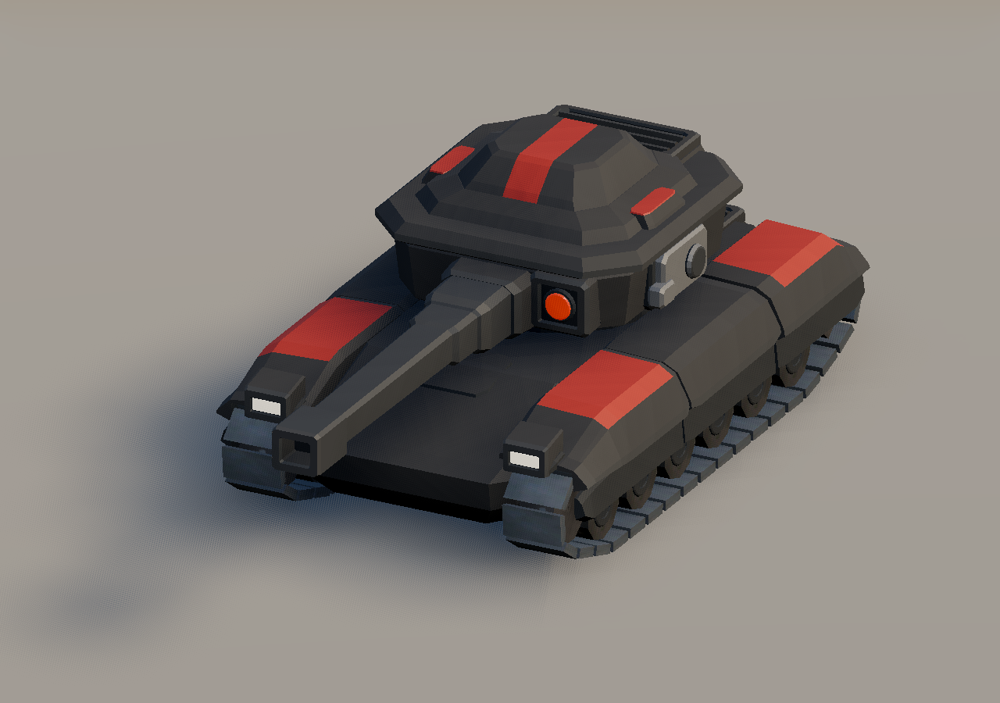

# Bastion tank prototype

Open [Bastion.blend](source/Bastion.blend) to edit the model. The [tank-only GLB](export/Bastion.glb) uses the current tank rig. To inspect it in Godot, extract the [standalone review project](validation/Bastion_Godot_Review.zip) outside Supply Lines, import its `project.godot` in Godot 4.7.2 and press **F5**. Use **Space** to change views and **C** to swap the team colours. [Review controls](validation/review/README.md)

[Side](preview/side.png) · [Rear](preview/rear.png) · [Red and blue](preview/teams.png) · [Original and Bastion](preview/comparison.png) · [Gameplay distance](preview/gameplay_comparison.png) · [Blender studio render](preview/bastion_studio.png)

The [production and validation report](validation/REPORT.md) records the dimensions, resource costs, gameplay checks and export commands.
