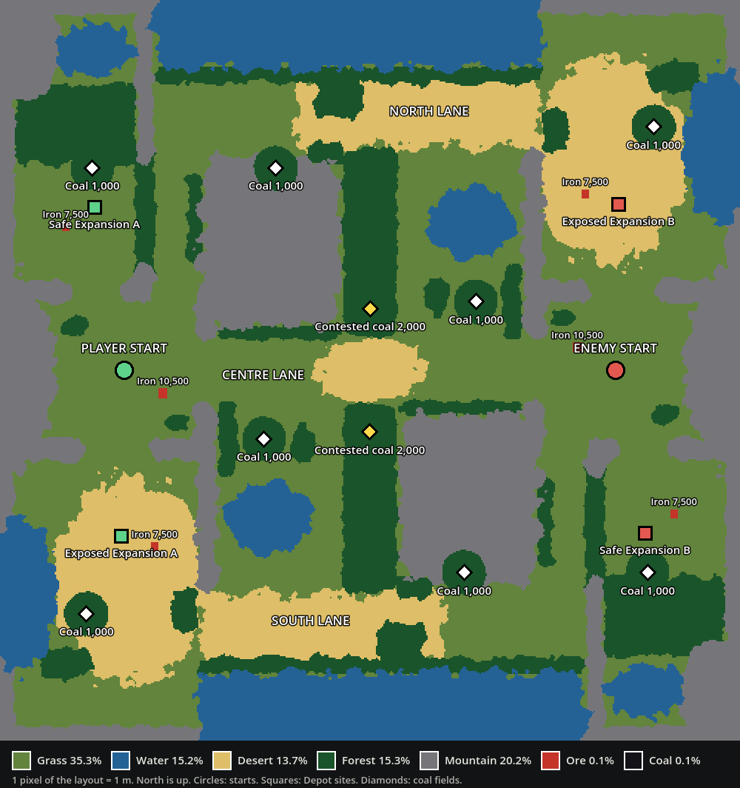

# Balanced two-player map and coal

A second map, built for a fair two-player match, and the first map with coal in the ground. Nobody has played it. The checks below prove the two sides measure the same; they prove nothing about how it plays.



This is the game's main scene: **F5** runs it. The original map, `resource_skirmish.tscn`, is unchanged and still playable with **F6** on its scene; most tests still use it. There is no scene picker in the game.

## Layout

The map keeps the 500 x 500 grid of 1 m cells. Start A (the player) is in the west and start B in the east. B's side is A's side turned half a circle about the map centre, so every distance and resource is the same for both.

- **Start.** A walled plateau about 90 m across with three doors: east to the centre lane, north-east to the north corridor, south to the exposed expansion. The Depot starts with 500 energy and no iron, with one Infantry and one fuelled Cargo truck. A 42-cell iron field (10,500 iron) lies inside the Depot's 35 m, with a starter mine already on it, because a mine costs iron. There is a small wood beside the Depot and no coal.
- **Safe expansion.** A pocket north of the main, entered only through the main. It has iron (7,500) and the nearest coal, 13 m from the Depot site. One stretch of its outer wall is forest instead of rock, so Scouts can slip in and a Tank can cut in.
- **Exposed expansion.** South of the main, with iron (7,500) and a coal field beyond it. It lies open to the south lane: the enemy can walk in without passing the main.
- **Three routes between the starts.** The centre lane (319 m), and the north and south lanes (569 m each), which stay at least 24 cells apart outside the mains. The centre lane narrows to about 40 m at midfield, between the two contested forests. An open passage on each side of midfield joins the centre lane to a side lane.
- **Coal.** Four fields a side of 1,000 coal each, and two contested fields of 2,000 either side of midfield. Every field sits inside forest; see the table for how much must be cleared.
- **Forest** covers 15.3% of the map (2.7% on the original). Besides the belts round the coal it fills the two passes at midfield, fringes the massifs, hangs a curtain across most of each side lane and narrows each corridor. Scouts cross all of it; Tanks cut roads through it.
- **Mountains and water.** Two massifs separate the centre lane from the side lanes. Walls close the mains and pockets. A sea runs along the far side of each side lane and a lake sits behind each forward coal field.
- **Lanes for rail.** Track pieces only run north-south and east-west, so the lanes do too: main to either expansion is a straight north-south run, and the centre, north and south lanes are straight east-west runs past the coal.
- Nothing to gather is nearer than 30 cells to the map edge.

Start B has no opponent. The scene has an `EnemyStart` marker, a mirrored starter mine, four Hostiles round start B and two beside each contested field. The markers under `Sites` show where each side is meant to settle; nothing reads them in play.

## Measured

From `tests/balanced_map_test.gd`. Distances are the shortest ground path over terrain alone, in metres. Start B gives the same figure on every row, to within 5 cm.

| | Each side |
| --- | --- |
| Start to starter mine | 18.6 |
| Start to safe expansion site | 120.8 |
| Start to exposed expansion site | 115.3 |
| Safe expansion to enemy start | 416.5 |
| Exposed expansion to enemy start | 403.7 |
| Enemy reaching the safe expansion without crossing its owner's main | no ground route |
| Exposed expansion to exposed expansion without crossing a main | 578.3 |
| Coal field 1 (forward, beside the centre lane): path to its forest, cells to clear, coal | 103.4, 9, 1,000 |
| Coal field 2 (safe expansion) | 133.6, 9, 1,000 |
| Coal field 3 (exposed expansion) | 162.7, 9, 1,000 |
| Coal field 4 (north lane for A, south lane for B) | 218.8, 9, 1,000 |
| Nearer contested field | 157.0, 12, 2,000 |
| Farther contested field | 167.8, 12, 2,000 |
| Safe expansion site to its coal's forest | 12.8 |
| Iron cells within 35 m of start, safe and exposed sites | 42, 30, 30 |
| Forest cells within 45 m of the start | 351 |

"Cells to clear" is the fewest Forest cells a worker must fell before it can stand within its 4 m reach of any coal. Until then no ground path reaches a field; the test also fells that corridor on the live terrain and checks the coal opens.

### The opening, by arithmetic

Worked out from the unit speeds in `assets/units`, the rules resources and the measured paths, for a player who makes no mistakes. Nothing here was played.

| Step | Target | Estimate | How |
| --- | --- | --- | --- |
| Infantry mining iron | 0:10 | 0:09 | 18.8 m walk at 2 m/s |
| Depot truck started | 1:00 | 0:57 | three loads of 10 over a 16.3 m leg |
| Second Depot and its Infantry | 2:00 | 1:51, plus the deploy animation | 14.2 s to build the truck, 120.8 m at 3 m/s |
| First coal in reach | 4:00 | 3:59 | 9 Forest cells at 13.5 s each, wood carried 4.3 m to the new Depot |
| First Tank | 6:00 | 5:49 if new vehicles start empty; 4:23 as shipped | see below |

The first Tank needs 130 iron with the truck and factory, which one Infantry mines by 4:04, and exactly the starting 500 energy. With `FuelRules.testing_full_tanks` on, as it is today, the Tank arrives fuelled and coal does not limit it. With that switch off it needs 60 coal in its Depot: dug at the safe expansion by 5:03 and trucked home, which gives 5:49.

## Coal rules

- **Category.** `COAL` is terrain category 6. Coal cells cannot be walked on or built on, like ore. Drones fly over them.
- **Amount.** Each Coal cell holds `coal_per_tile` (50) from `assets/economy/harvesting_rules.tres`. Fields are drawn 20 cells large, so they hold 1,000; contested fields are 40 cells and hold 2,000.
- **Digging.** Infantry take coal straight from a cell, the way they take wood from a Forest cell: right-click a Coal cell, or use Gather and click it. They carry 10, dig 5 per 1.2 s and deliver to a friendly Depot, deployed Cargo vehicle or crate. Both teams draw on the same cell.
- **Field.** A cell that runs out is dug out to bare open ground, and the worker moves on to the nearest cell of the same field that still holds coal. It stops when the field is empty.
- **Reach.** A worker must stand within its 4 m reach of the cell. Inside uncut forest it reports "Coal unreachable".
- **Drawn.** The ground shader draws Coal cells as dark seam, and two lumps stand on each cell and shrink away when it is dug out. The minimap marks every field that still holds coal and shows dug-out cells. Pointing at a Coal cell shows what it and its field hold.
- **No coal mine building.** Whether coal should need one is undecided; see below.
- **Start conditions on this map.** `testing_coal_amount` is 0, so there is no testing coal pile. The pile still works in the scenes that set an amount. `testing_iron_grant` is off, so Depots here do not take the 500-iron testing grant; every other scene keeps it.

### Open questions

1. Should coal need a mine building, as iron does, or stay directly dug?
2. Should a dug-out Coal cell become open ground? Ore cells stay blocked when exhausted. Coal follows Forest here because otherwise the middle of a field is out of reach.
3. Should workers move on through a field by themselves? Wood has no such chaining; without it coal needs a new order every five loads.
4. Are 50 a cell and 1,000 a field right, and should contested fields be twice a side field?
5. Should new vehicles start empty on this map (`FuelRules.testing_full_tanks` off)? That is what makes coal limit the first Tank.
6. Water-adjacent generation and crates costing wood are still deferred and not part of this.

## Files

Everything for this map is separate from the original map's files.

| File | What it is |
| --- | --- |
| `assets/maps/balanced/layout.png` | The source: an indexed PNG, one pixel per cell, one palette colour per category. Edit this in a paint program. |
| `assets/maps/balanced/terrain_cells.bin` | The cells gameplay reads. Built from the layout. |
| `assets/maps/balanced/terrain_data.png` | The same categories for the ground shader. Lossless. |
| `assets/maps/balanced/terrain_surface.png` | Soft ground colours for the shader's tint, and the colour of ore. |
| `assets/maps/balanced/ground_blend.png`, `mountains.res` | The grass and desert border map and the sculpted mountain mesh. |
| `assets/maps/balanced/terrain_surface.tres`, `mountain_massif.tres` | This map's ground and rock materials. |
| `scenes/maps/balanced_terrain.tscn`, `balanced_terrain_landmarks.tscn` | The terrain scene and its baked scenery. |
| `scenes/maps/balanced_skirmish.tscn` | The playable scene. |
| `scenes/terrain/coal_deposit.tscn` | The coal lump the baker stands on Coal cells. |

Layout palette, from `scripts/tools/map_layout.gd` (index = category):

| Index | Category | Colour |
| --- | --- | --- |
| 0 | Grass | `#62843C` |
| 1 | Water | `#246296` |
| 2 | Desert | `#DEBE68` |
| 3 | Forest | `#1A542A` |
| 4 | Mountain | `#76767A` |
| 5 | Ore (iron) | `#C43428` |
| 6 | Coal | `#121218` |

A pixel of any other colour stops the build and names its position. The layout may be saved back as indexed or as plain RGB.

### Regenerate after editing the layout

```bash
godot --headless --path . --script res://scripts/tools/build_map_data.gd -- --map=res://assets/maps/balanced
godot --headless --path . --script res://scripts/tools/build_ground_blend_map.gd -- --cells=res://assets/maps/balanced/terrain_cells.bin --output=res://assets/maps/balanced/ground_blend.png
godot --headless --path . --script res://scripts/tools/build_mountain_mesh.gd -- --cells=res://assets/maps/balanced/terrain_cells.bin --mesh=res://assets/maps/balanced/mountains.res --material=res://assets/maps/balanced/mountain_massif.tres
godot --headless --path . --import
godot --headless --path . --script res://scripts/tools/rebuild_terrain_scenery.gd -- --terrain=res://scenes/maps/balanced_terrain.tscn
godot --headless --path . --script res://tests/balanced_map_test.gd
godot --path . --script res://scripts/tools/draw_map_preview.gd
```

- The last scenery step is the same as pressing **Rebuild terrain scenery** on the root of `balanced_terrain.tscn`.
- Hand edits must keep the two sides the same: whatever is painted at cell x, z must also be painted at 499-x, 499-z. The test names the first cell that differs.
- If an edit moves a start or an expansion, move its marker in `balanced_skirmish.tscn` and its partner (x and z negated).
- `scripts/tools/draw_balanced_layout.gd` drew the first layout and can draw it again. Running it overwrites hand edits to the PNG.

## Shared code this needed

- `terrain_grid.gd` has an exported `cells_path`; the original terrain scene keeps the default. `terrain_assets.gd` bakes from that path into its own `landmarks_path`, and has slots for `coal_scene` and `forest_chunk_metres`.
- The map tools take their files after `--` (`scripts/tools/tool_args.gd`): `--cells`, `--mesh`, `--material`, `--output`, `--terrain`. Without arguments each does what it did before; rebuilding the original map's scenery gives the same batches as before.
- Forest batches on this map are split into 50 m squares so the renderer skips the ones off screen. The original map is left as one batch per patch scene.
- The sculpted landscape (LANDSCAPE_LOOKDEV.md) does not know coal or per-map files: its baker and shader would treat a Coal cell as plain ground, and it writes the original map's meshes. The balanced terrain leaves its `landscape` slot empty and uses the flat ground, the sculpted mountains and the forest patches.
- Draft PR #53 changes the same baking code. These changes were kept to added parameters so the two can be reconciled. A trial merge with its head (`6a23008`) had no text conflicts; nothing was run on the merged tree.

## Needs judging in play

- **Timing.** The estimates above assume no mistakes and ignore the deploy animation, clicking and unit traffic.
- **Coal before iron.** A player who walks the first Infantry and the starter truck straight to the forward field could reach coal at about 2:00 to 2:30 by the same arithmetic, with no iron income. Coal is little use without iron, but if this proves strong, deepen that belt or move the field east.
- **Belt depth.** 9 cells is about two minutes of sawing with a Depot beside it, and much longer when every load of wood is carried far. A Tank drives straight through. Whether that is real Infantry time or tedium needs your eye. Clearing a 9-cell corridor also yields 180 wood, worth 1,800 energy in a Generator.
- **Coal amounts,** and whether 2,000 is enough reason to fight at midfield.
- **Safe and exposed.** Both expansions are about equally far from the enemy by ground; the difference is that the exposed one can be reached without passing the main.
- **Resistance.** Hostiles hold their ground and fire at 15 m (docs/PATHING.md). They do not cover the middle of the centre lane.
- **Look.** Coal lumps, the dark seam and the large flat-topped massifs were set by eye from four renders. Water borders keep the blocky steps of the cells.
- **Frame rate.** On one machine with vertical sync off the whole-map view drew 2.3 million triangles at about 280 frames a second, against 1.4 million and about 400 to 460 on the original map. Slower machines were not tried.

## Checks

- `tests/balanced_map_test.gd` (headless): the cells match the layout PNG and `terrain_data.png`; the layout is symmetric; category counts; the start is 500 energy and no iron with one Infantry and a fuelled truck; no testing pile; starts, sites and mines mirror each other; Depot footprints and the ground round each start are buildable; iron inside 35 m of every site; no coal inside 35 m of a start; every coal field enclosed, with its depth; 3 to 5 fields a side and 1 or 2 richer contested ones; the safe expansion unreachable without the main; at least two separate routes; and every metric equal for both sides. Prints the tables above.
- `tests/coal_gathering_test.gd` (headless): Coal cells block walking and building; a cell is finite and shared; enclosed coal is refused; a new Depot's Infantry digs, delivers 60 coal and moves on to the next cell; the dug-out cell opens and loses its lumps; the right-click order and hover card; the field running out; and a Generator burning the delivered coal.
- `tests/balanced_map_runtime_check.gd` (rendered): the map draws, coal reads dark, the minimap marks coal, and it saves an overview, the start, a coal field and a contested field.
