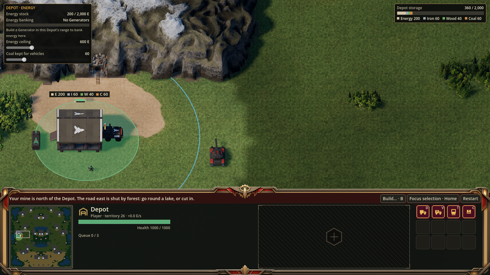

# Fog of war

Asked for on 2026-11-19, together with an enemy AI player, which is to follow the same rules. The user chose dim fog with no black shroud: the whole map always shows, dimmed outside your sight.

## Rules

- **Sight.** Each side sees round its own units and buildings.
  - A unit sees as far as its `vision` (`assets/units/*.tres`): Infantry 30 m, Motorcycle 30 m, Grenadier 32 m, Ubermech 36 m, Scout 50 m, Tank 52 m, Drone 60 m.
  - Units with no vision of their own, such as trucks and trains, see 20 m.
  - A Depot sees 36 m, other buildings 24 m, and a build site 12 m.
  - These are exports on `scenes/gameplay/fog_of_war.tscn`.
- **The map always shows.** Terrain, forests, lakes, mountains, coal and the shared mines are always drawn. Outside your sight they are dimmed, on the map and on the minimap.
- **The other side shows only in sight.** Enemy units, buildings, build sites, crates and track are hidden outside your sight, on the map and on the minimap. Nothing of theirs is remembered: a building you saw once disappears again when you no longer see it.
  - Hidden things can't be clicked or picked from the minimap.
  - Their shots are hidden too, unless they leave or land in your sight.
- **What each side has seen** stays recorded (`explored_by`), for the enemy player to remember.
- **Updates** run every 0.2 s on cells 2 m across.
- **Combat is unchanged.** Units still fire at whatever is in range. Every unit sees further than it shoots, so nothing fires from out of sight.

## How it works

- `scenes/gameplay/fog_of_war.tscn` is saved into Two Lakes and the balanced map, beside the camera. The First Contact map, the terrain review world and the test maps have none, so they play as before.
- `scripts/gameplay/fog_of_war.gd` keeps one image per side:
  - Its alpha is 1 in fog and 0 in sight. Each update fills it and clears a disc round every unit and building, a row at a time (`Image.fill_rect`).
  - `visible_to(team, point)` and `explored_by(team, point)` answer for either side.
  - The node then shows or hides the other side's things for the viewer (`viewer`, "player").
- `assets/shaders/fog_of_war.gdshader` is one pass over the whole screen, drawn last.
  - It reads the scene's depth, finds the ground under each pixel, and darkens it by the fog image's alpha (`strength` 0.55, `fog_color`).
  - Ground on a mountainside is placed where it really is, so fog follows the slopes.
  - With no fog image (the editor), it draws nothing.
- `scripts/ui/tactical_minimap.gd` draws the same image over the minimap and skips hidden markers. `skirmish.gd` hides fogged shots (`show_shot`) and turns down minimap picks of hidden things (`pick_distance`).

## Checks

- `tests/fog_of_war_test.gd` (headless, Two Lakes):
  - each side sees its own start and not the other's;
  - the East start's enemies are hidden, while your units and the mines are not;
  - each unit's own vision applies (Tank against Infantry at 40 m);
  - ground once seen stays explored;
  - minimap picks of hidden enemies are turned down;
  - fogged shots are hidden;
  - the shade is clear at the Depot and dark at the East start.
- `tests/fog_of_war_runtime_check.gd` (rendered):
  - ground in sight is not dimmed, and ground in fog is (about 0.63 of its brightness);
  - an enemy shows once inside sight;
  - it saves `fog_edge`, `fog_off`, `fog_enemy` and `fog_minimap`.

## Not done yet

- The enemy AI player, to these rules, is the next PR.
- A smooth fade as units move; the edge moves in 2 m steps every 0.2 s.
- Fog on the First Contact and test maps.

## Plans need sight (2026-11-19)

- A plan from the Build page can only be placed where you see every cell of its site (`DepotNetwork.in_sight`).
- Out of sight, the preview is red and says so, and a click is refused with a note.
- A Cargo vehicle's Worksite can still place a site out of sight: the trucks drive out to it. See `HUD_POLISH.md`.
