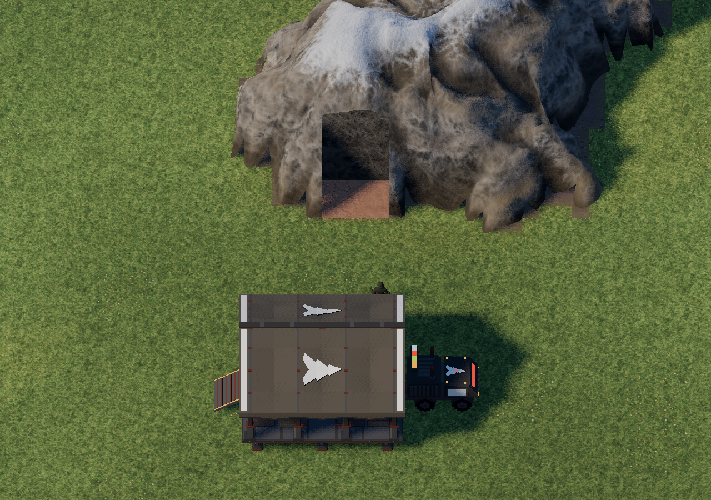

# Mine sites

A mine site is a terrain kind: a recess cut into the side of a mountain, 4 cells across and 3 deep, in which only an Iron Mine can be built. It is the first step towards iron mines that are dug into the rock instead of standing on a field of ore rocks. The older Ore kind still works as before, and both can be on one map.

A mine built on a site is the portal mine of [PORTAL_MINE_MODEL.md](PORTAL_MINE_MODEL.md): a steel portal in a collar of rock, with a track and an ore cart, a hoist, a winch house and tanks. It fills the cut and looks out of it. A mine on an ore field is still the pithead of [IRON_MINE_MODEL.md](IRON_MINE_MODEL.md).

| A bare site | A mine in it |
| --- | --- |
|  |  |

## Rules

- **Kind 7, "Mine site".** `Terrain.MINE_SITE` in `scripts/terrain/terrain_grid.gd`; layout colour `#EC7A1C` (orange) in `scripts/tools/map_layout.gd`.
- **Shape.** Every site is a block 4 cells across the rock face and 3 deep into it (`MapLayout.MINE_SITE_SIZE`): 4 x 3 on the layout when it looks north or south, 3 x 4 when it looks east or west.
- **Cut into a mountain.** Mountain cells lie all along the site's back and both its flanks. The site's own cells are drawn in place of Mountain cells at the mountain's edge.
- **Open in front.** The ground across its front is grass or desert for two rows out. Those eight cells are kept clear for the mine's rails and carts (`TerrainGrid.is_mine_front`): units walk across them, nothing can be built on them.
- **Checked when the map is built.** `scripts/tools/build_map_data.gd` stops and names any site that breaks these rules (`MapLayout.mine_site_errors`).
- **Nothing else stands there.** Site cells cannot be walked on or built on. An Iron Mine takes the whole site (`TerrainGrid.ore_footprint_valid`, `mine_site_rect`), and it still has to be inside the paying stockpile's range.
- **Placing.** Pointing at any cell of a site chooses the whole site, for building directly and for a planned mine (`DepotNetwork.mine_spot`). The mine's ordinary 2 x 2 footprint (`mine_footprint`) still applies on Ore cells.
- **Facing.** `TerrainGrid.mine_site_facing` gives the way out of the recess; `iron_mine.gd` turns the mine's `Visuals` that way. A mine on an ore field is not turned.
- **Iron.** A site holds `iron_per_site_tile` (625) per cell, 7,500 for the site, in `assets/economy/harvesting_rules.tres`: as much as one of the balanced map's ore fields, where a mine on Ore cells holds 1,000. The mine is shared and mined exactly as before.

## The cut in the mountain

`scripts/tools/build_mountain_mesh.gd` shapes the mountain as if the site were still rock, so the mountain keeps its height around it. It then leaves the mesh open over the site's cells and closes the opening with sheer walls down to the ground. The mountain's outline normally wanders a few metres from the cells; within 6 m of a site it is held to the cells, so the cut lines up with the mine. The walls are low at the mouth and rise to the mountain's own height at the back.

The floor of the cut is the ground shader's kind 7: the stony ground of the mountain foot, stained with rust (`mine_site_stain`). No ore rocks stand on it.

For the portal mine, the cut gives a level floor 4 m across and 3 m deep at ground height, a back wall across its full width, a side wall on each flank, and a clear strip 4 m across and 2 m deep on the open ground in front.

**Which way a site faces matters to the eye.** The game looks north and down. A site that faces south opens towards the camera and is seen whole. One that faces east or west is seen side-on, half hidden by the mountain's own shoulders (`images/mine_site_east.png`), and one that faces north is hidden behind the mountain altogether. A layout should face its sites south where it can.

## Trial map

`scenes/maps/mine_site_exercise.tscn` is the balanced map with eight mine sites cut into its mountains, four near each start, one facing each way. `SiteDepot`, with an Infantry beside it, stands in front of the nearest site north of start A, so a mine can be built in it straight away: select the Depot, press B, choose Iron Mine and place it on the rust-coloured floor of the cut.

| File | What it is |
| --- | --- |
| `scripts/tools/draw_mine_site_layout.gd` | Draws `assets/maps/mine_sites/layout.png` from the balanced map's cells: for each way a mine can face, the nearest sound spot to start A, and its mirror for start B. |
| `assets/maps/mine_sites/` | The trial map's layout, the files built from it and its mountain mesh. |
| `scenes/maps/mine_site_terrain.tscn`, `mine_site_terrain_landmarks.tscn` | Its terrain and saved scenery. They use the balanced map's water meshes and rock material. |
| `tests/mine_sites_test.gd` | Headless: the layout rule, the build rule, the clear strip, facing, reserves and sharing. |
| `tests/mine_sites_runtime_check.gd` | Rendered: a bare site, a mine in it, and a mine facing east. |

Rebuild after changing the tool:

```bash
godot --headless --path . --script res://scripts/tools/draw_mine_site_layout.gd
godot --headless --path . --script res://scripts/tools/build_map_data.gd -- --map=res://assets/maps/mine_sites
godot --headless --path . --script res://scripts/tools/build_ground_blend_map.gd -- --cells=res://assets/maps/mine_sites/terrain_cells.bin --output=res://assets/maps/mine_sites/ground_blend.png
godot --headless --path . --script res://scripts/tools/build_mountain_mesh.gd -- --cells=res://assets/maps/mine_sites/terrain_cells.bin --mesh=res://assets/maps/mine_sites/mountains.res --material=res://assets/maps/balanced/mountain_massif.tres
godot --headless --path . --import
godot --headless --path . --script res://scripts/tools/rebuild_terrain_scenery.gd -- --terrain=res://scenes/maps/mine_site_terrain.tscn
```

## Not done yet

- The construction site's fence model only exists for square footprints, so a mine planned on a site shows the plain plan grid while it is built.
- No ore vein is drawn on the rock, and a bare site has no marker beyond its stained floor and the orange block on the minimap.
- The minimap and `draw_map_preview.gd` do not label a site's iron.
- 7,500 iron a site is a placeholder taken from the balanced map's ore fields, not a balanced figure.
- The balanced map itself has no mine sites; only the trial map does.
