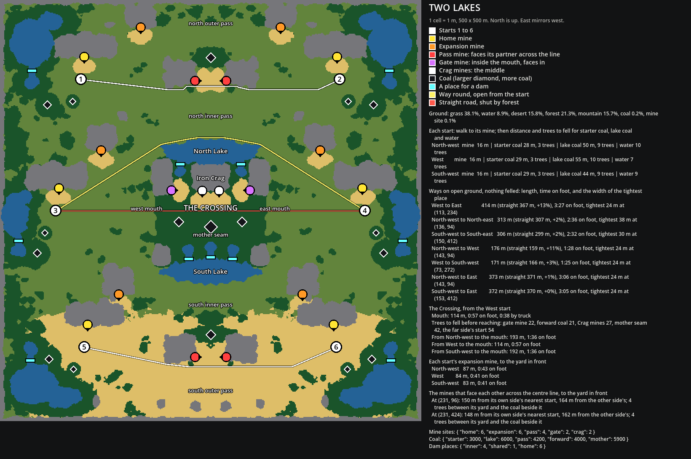

# Two Lakes

Two Lakes is a 500 x 500 m map for up to six players, playable as `scenes/maps/lakes_skirmish.tscn`. It is not the main scene; the balanced map (`BALANCED_MAP.md`) still is. The design was agreed in conversation on 2026-11-15 and 16.



## The idea

The goal of a game is to take the middle and entrench there, and so out-produce the other side. The map is built to make that the natural thing to fight over, while the ways round the middle are open from the first minute.

- **The Crossing.** The middle is a neck of forest between two small lakes, on the straight line between west and east. It is shut at first: Scouts slip through, a Tank cuts a road by driving in, Infantry fell their way in. Water closes both its flanks, so whoever holds it has two mouths to guard, each about 58 m wide.
- **What it holds.** Everything that matters late, within about 40 m:
  - the Iron Crag on the north shore, with twin mines facing south into the Crossing, and a gate mine inside each mouth that faces in, at the other side's;
  - the mother seam of coal at the very middle, the largest field on the map, and a field inside each mouth;
  - five places for a dam (two on the north lake, three on the south), against one at each start's own lake.
- **The lane opens.** The Crag stands on the north shore only. No rock divides the Crossing; once the trees are felled the straight road is open from end to end.
- **The ways round.** The central lakes are small, so the ways round their outer shores are short and open. The early game is fought there. In each field a pair of mines stand in facing mountains either side of the centre line, each looking at its partner, with coal between them walled by the rock. The pairs split each field into an inner pass (by the lake) and an outer pass (by the map's edge).
- **Every start has the same to hand:** a mine in the mountain just north of it, a wood with a small coal field a few trees in, and a lake of its own behind forest, with a second coal field and a place for a dam. An expansion mine stands on the way out of each.
- **Mirrored, not turned.** The east is the west mirrored left to right. The game looks north, so a mine that faced north would be hidden behind its mountain; a mirror keeps every mine facing the same way for both sides. No mine faces north. The north (grass) and the south (desert) differ in their arrangement and are balanced by measurement, not by shape.
- **Forest for Scouts.** Belts of forest along the west and east edges join the starts' woods, and woods and copses are scattered over the open ground, so a Scout can cross much of the map under cover.

## Measured

`scripts/tools/draw_lakes_layout.gd` prints these each time it draws the layout, and writes them on the picture. Lengths are as a unit walks them, in straight lines over open ground; times are for Infantry at 2 m/s.

| Way, on open ground with nothing felled | Length | Longer than straight | On foot | Tightest place |
| --- | --- | --- | --- | --- |
| West to East | 414 m | 13% | 3:27 | 24 m |
| North-west to North-east | 313 m | 2% | 2:36 | 38 m |
| South-west to South-east | 306 m | 2% | 2:32 | 30 m |
| A corner start to the opposite middle start | about 373 m | 1% | 3:06 | 24 m |
| Between neighbours on one side | 171 to 176 m | 3 to 11% | about 1:27 | 24 m |

| From each start | Distance | Trees to fell first |
| --- | --- | --- |
| Home mine | 16 m | 0 |
| Starter coal (500) | 28 to 29 m | 3 |
| Lake coal (1,000) | 44 to 55 m | 9 to 10 |
| Its lake's water | | 7 to 10 |
| Expansion mine | 83 to 87 m | 0 |

These are measured from the layout's start points. In the playable scene, the West and East starts (their Depot, `Sites` marker and units) stand 8 m further north, after the playtest of 2026-11-17 asked for the start to be a little closer to its mine. The walk to the home mine's yard is about 8 m, and the Depot's centre is 19 m from the mine's instead of 27 m. Everything else is about 8 m further. The other four starts' markers are where the layout puts them.

- **Into the Crossing from the West start:** the mouth is 114 m away (0:57 on foot, 0:38 by truck). Trees to fell before reaching the gate mine 22, the coal inside the mouth 21, the Crag's mines 27, the mother seam 42, and right through to the other side 54.
- **From a corner start** the mouth is about 193 m (1:36).
- **The pass mines** are about 150 m from the nearest start on their own side and 163 m from the other side's, with nothing to fell. The coal between them is 4 trees in from the yard.
- **Totals:** 20 mine sites (6 home, 6 expansion, 4 pass, 2 gate, 2 Crag), each holding 7,500 iron; 17 coal fields holding 23,100 (starter 3,000, lake 6,000, pass 4,200, mouth 4,000, mother seam 5,900); 11 places for a dam.
- **Ground:** grass 38%, forest 21%, desert 16%, mountain 16%, water 9%.

## Files

| File | What it is |
| --- | --- |
| `scripts/tools/draw_lakes_layout.gd` | Draws `assets/maps/lakes/layout.png` from scratch, measures it and writes `docs/images/two_lakes_layout.png`. Running it again overwrites hand edits to the layout. |
| `assets/maps/lakes/` | The layout, the files built from it, the ground material, the mountain mesh and the sunken water's meshes. |
| `scenes/maps/lakes_terrain.tscn`, `lakes_terrain_landmarks.tscn` | The terrain and its saved scenery. |
| `scenes/maps/lakes_skirmish.tscn` | The playable scene. Every one of the 20 mine sites has its mine from the start (they are shared, so any side's Infantry can work them). The player holds the West start; the East start has one enemy of each unit type, as on the balanced map. The other four starts are markers under `Sites`. |
| `tests/two_lakes_map_test.gd` | Headless: the mirror, the mine sites, the coal, the built home mines, and that the open way goes round a lake while the straight road is shut by forest. |
| `tests/two_lakes_runtime_check.gd` | Rendered: the whole map, the West start, the Crossing, the Crag and a pass, and the frame rate. |

Rebuild after changing the layout tool or editing `layout.png` (skip the first line to keep hand edits):

```bash
godot --path . --script res://scripts/tools/draw_lakes_layout.gd
godot --headless --path . --script res://scripts/tools/build_map_data.gd -- --map=res://assets/maps/lakes
godot --headless --path . --script res://scripts/tools/build_ground_blend_map.gd -- --cells=res://assets/maps/lakes/terrain_cells.bin --output=res://assets/maps/lakes/ground_blend.png
godot --headless --path . --script res://scripts/tools/build_mountain_mesh.gd -- --cells=res://assets/maps/lakes/terrain_cells.bin --mesh=res://assets/maps/lakes/mountains.res --material=res://assets/maps/balanced/mountain_massif.tres
godot --headless --path . --script res://scripts/tools/build_water_basin.gd -- --cells=res://assets/maps/lakes/terrain_cells.bin --basin=res://assets/maps/lakes/water_basin.res --surface=res://assets/maps/lakes/water_surface.res
godot --headless --path . --import
godot --headless --path . --script res://scripts/tools/rebuild_terrain_scenery.gd -- --terrain=res://scenes/maps/lakes_terrain.tscn
godot --headless --path . --script res://tests/two_lakes_map_test.gd
```

The map's `terrain_data.png` and `ground_blend.png` must stay uncompressed (`detect_3d/compress_to=0` in their `.import` files), as on the other maps.

## How it is drawn

- **Mines stand from the start**, so the rock round each cut is shaped to meet one: about 4.7 m high at the cut's back, where the mine's own rock collar ends, falling to 1.7 m at its mouth and rising again away from the cut (`SITE_BACK`, `SITE_MOUTH`, `SITE_SLOPE` in `scripts/tools/build_mountain_mesh.gd`).
- **Coal lies in the ground.** No lumps stand on it: the terrain's `coal_scene` slot is empty, and the ground shader draws each Coal cell as black, broken rock with a dull shine. A cell that is dug out is drawn as bare earth, as before.

## Not settled

- **Dams have no rules yet.** Each place for one is drawn as a channel 7 m wide between a lake and a small bay. Their number and positions are placeholders.
- **The middle may not be worth enough in a two-player game,** where each side has three starts' worth of safe mines, coal and dam places on its own half. Making the Crag's sites richer than ordinary ones would be a rule change, not a map change.
- **The Crossing may be too easy to hold:** two mouths of 58 m against a Tank's 30 m range. Only play will tell.
- **Mines that face east or west** (the pass and gate mines) are partly hidden by their mountain from the game's camera. Each stands at the south end of its face, where the rock in front is lowest.
- **Only two starts are in play.** The scene has no way yet to choose starts or add players.
- **Frame rate** at 1280 x 900 on the development machine (2026-11-16): 392 frames a second at the West start, 169 over the Crossing, 56 with the whole map in view (15.9 million triangles, mostly forest tiles).
